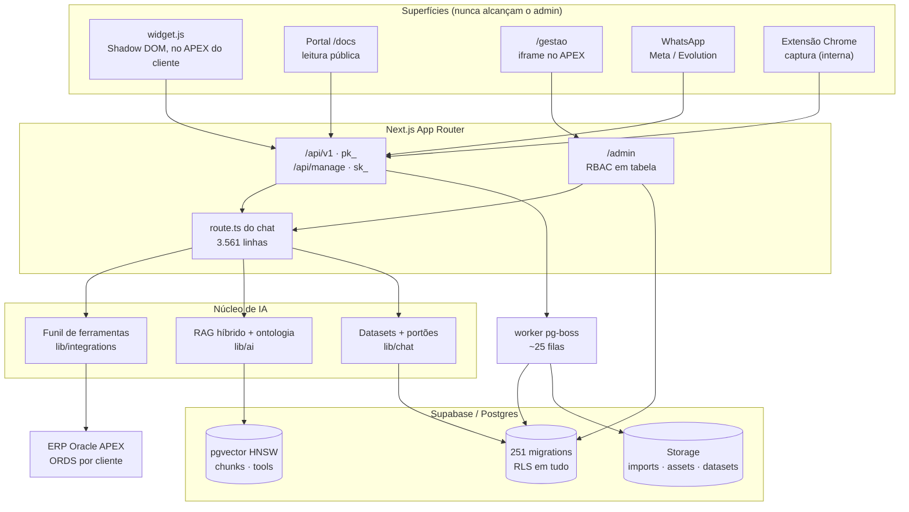

# Mapa do código

> Gerado pelo Cartographer em 2026-09-22, com 15 agentes lendo 1.403 arquivos
> (2,40M tokens). Ficaram de fora 220 arquivos (755k tokens) que não são o
> produto: skills de agente (`.claude/`, `.agents/`, `agent/skills`), dumps SQL
> de referência do ERP (`vscode-claude/`), o logo em base64, os relatórios de
> rodada em `eval/*.md` e o guia externo de 4.177 linhas.
>
> **Atualizado em 2026-10-14** (modo incremental, 4 agentes): 172 commits e 204
> arquivos desde `4d410d0`. Entraram as seções de identidade por base, motor de
> elegibilidade, documentações anexáveis e arquivos da base, portal `/gestao`
> com créditos e campanhas, e a camada de IA com Maritaca, OCR, contingência,
> reserva e `gemini-embedding-2`. O resto foi mantido como estava.
>
> **Este mapa não substitui `docs/estado-e-proximos-passos.md`** — aquele diz o
> que está aberto HOJE; este diz onde as coisas moram e por que estão assim.

## O que este repositório é

Duas coisas num repositório só, e quem lê só metade toma decisão errada:

1. **Uma plataforma de base de conhecimento** (admin + portal público + widget
   embutível) — Next.js App Router, Supabase, editor de blocos próprio.
2. **Um chatbot de IA sobre o ERP Oracle APEX da Natcorp** — ~88 ferramentas de
   integração, RAG híbrido, multi-cliente com isolamento rígido por base.

O objetivo declarado do segundo é **assertividade acima de tudo**; velocidade e
custo vêm depois. Isso explica quase toda decisão estranha que você vai
encontrar.

### A característica mais incomum deste código

Os comentários registram **medições e hipóteses reprovadas**, com número e data:

> *"alargar o teto do top-K de 12 para 88 é inerte: 73/97 em todos os valores"*
> *"o gap mediano entre 1ª e 2ª ferramenta é 0,020, e em 46,9% dos turnos as duas estão a menos de 0,02"*
> *"cache 25%→30% e custo +5,6% — a chave fica no código, desligada, para a ideia não voltar sem o número junto"*

Trate cada `MAX_*`, `MIN_*` e limiar como resultado de experimento, não como
preferência. Vários "consertos óbvios" já foram tentados, medidos e revertidos —
e o comentário que explica isso costuma estar no arquivo que você ia mexer.

---

## Visão do sistema



**A regra de ouro do produto:** portal, widget e `/gestao` nunca têm rota, código
ou credencial que alcance o admin. A separação é por rota, por RLS e por chave —
não por checagem em componente.

**E a regra que a acompanha desde setembro:** widget, portal e `/gestao` leem e
gravam com `service_role`, que ignora a RLS. Entre clientes, quem cerca é o
código (base tirada do token verificado ou da sessão, nunca do formulário) e as
funções SQL que recebem `p_base`. Ver Gotcha 11.

---

## Estrutura de diretórios

```text
src/
  app/
    (admin)/admin/          431k tok — o console interno
      (auth)/               login → MFA obrigatório (AAL2) → definir senha
      (app)/                ~20 telas; padrão page.tsx + *-manager.tsx + actions.ts
        conteudo/           o editor + ~15 arquivos de server actions
        integracoes/        9 abas: bases, tools, agentes, fluxo, execuções…
        importar/           upload → extração → prévia → materializar
        ontologia/          glossário + dicionário de dados do APEX
        sistema/            IA, e-mail, backup, prompts (segredos = Owner)
        usuarios/           RBAC, convites, regra de não-escalada
    (portal)/docs/          portal público, leitura contínua por diretório
    gestao/                 área do cliente, iframe no APEX; 7 abas: Consumo,
                            Créditos, Acessos, Prompts, Conteúdo, Comunicação,
                            Conversas (sem login próprio: token HMAC na URL)
    api/
      v1/                   chave pk_ (widget) — SSE no chat
      manage/v1/            chave sk_ (server-to-server, escopos = RBAC)
      portal/ whatsapp/     superfícies públicas com rate limit
  lib/
    integrations/  219k     catálogo e roteamento das ~88 ferramentas
    chat/          219k     datasets, portões, fatos, anexos, prompt de tela
    ai/            106k     RAG, ontologia, cascata de prompt, config por finalidade
    blocks/         83k     motor de blocos JSON (substituiu o TipTap)
    importer/       81k     PDF/DOCX/PPTX/XLSX → árvore de artigos
    content/                árvore, overlays de cliente, chunking, publicação
    reports/                PDF/DOCX/XLSX/PPTX com a identidade Natcorp
    tracking/               identidade p_* por token HMAC, chave por base, catraca
    elegibilidade/          motor único "esta regra alcança esta pessoa" (12 dimensões)
    documentacoes/          documentações anexáveis, arquivos da base, download
    gestao/                 sessão, portão de crédito, dois baldes, bloco APEX
    campanhas/              avisos agendados que o widget mostra (entrega em widget/)
    prompts/                prompts sugeridos (catálogo global e por base)
    portal/ widget/ analyze/ apex/ backup/ ext/ whatsapp/
  components/
    editor/         100k    editor de blocos (canvas, painel de propriedades)
    ui/                     design system (42 primitivos)
    portal/ content/ admin/ gestao/
supabase/migrations/        251 arquivos, idempotentes, sem ledger; funções de
                            escopo e elegibilidade têm SÍTIO ÚNICO (ver Gotcha 15)
scripts/              168k  os INSTRUMENTOS de medição (ver seção própria)
worker/                     pg-boss, ~25 filas, roda separado do web
apex/                       PL/SQL que o CLIENTE cola no APEX dele
oracle/                     pacotes PL/SQL de metadado e coleta de IR
.audit/                     scripts read-only contra o banco real
apps/extension/             extensão Chrome MV3 (interna, Fase 5)
docs/                       arquitetura, regras de negócio, estado corrente
eval/                       gabaritos (.jsonl) e relatórios de rodada
```

---

## Guia dos módulos

### `src/lib/integrations` — o funil das ferramentas

**A superfície mais medida do projeto.** Decide quais das ~88 ferramentas chegam
ao modelo em cada turno.

O caminho, em ordem, com o arquivo de cada etapa:

| # | Etapa | Arquivo | Teto/limiar |
|---|---|---|---|
| 1 | Contexto da base (cache) | `resolve.ts` | TTL 60s |
| 2 | Precisa de dados? Qual assunto? | `module-select.ts` | até 4 módulos |
| 3 | Quebra em facetas | `facets.ts` | `MAX_FACETAS=8` |
| 4 | Top-K semântico + resgate | `tool-catalog.ts`, `tool-narrow.ts` | `MIN_SEM=0.60`, `MIN_ANTIFLOOD=0.58` |
| 5 | Cobertura do catálogo | `cobertura.ts` | 6 candidatas, desc. 150 chars |
| 6 | Bônus por uso histórico | `aprendizado.ts` | `MAX_BONUS=0.06`, ≥3 amostras |
| 7 | Acesso (regras + taxonomia ERP) | `acesso-regras.ts` | negar vence, empate fecha |
| 8 | Teto final por faixa | `teto-tools.ts` | forçadas › deps › similaridade |
| 9 | Execução + retry + paginação | `executor.ts`, `retry-policy.ts` | retry só em GET/HEAD |
| 10 | Guards pré-chamada | `guards.ts` | 7 guards, falha fechada |

`MAX_TOOLS_MODELO = 6` (era 12) · `MAX_TOOLS_COMPOSTO = 18` · `TETO_DURO = 12` ·
`MAX_CHAMADAS_INTEGRACAO = 40`.

**Escopo por painel** (`panel-scope.ts`): PO=tudo, PG=equipe, PC=próprios,
PCAND=silêncio significa **bloqueado** (inverte o padrão dos outros).

### `src/lib/ai` — RAG, ontologia e prompt

Pipeline: reescrita de consulta (só quando a mensagem depende do turno anterior)
→ expansão por ontologia → embedding (cache 1h) → RPC `hybrid_search_scoped`
(léxico + vetor + boost, fusão **RRF k=60**) → vínculo termo→artigo → memória de
continuidade → desambiguação de tema → confiança (`LIMIAR_CONFIANCA = 0.022`).

**Composição do prompt** (`system-prompt.ts`): persona → especialização → uso das
ferramentas → linguagem → **regras por último** → CONTEXTO. As regras vão por
último para que texto do usuário não empurre a política para fora. `prompt-split.ts`
separa diretriz (fica no system) de dado (`dado_tela` antes do histórico,
`dado_pergunta` colado na última mensagem) — tudo a serviço do cache de prefixo.

**Config por finalidade** (`config.ts`, `catalog.ts`). São 11 finalidades:

| Finalidade | Como é chamada | Observação |
|---|---|---|
| `chat` | `chatModel` / `languageModel("chat")` | turno sem ferramenta, portal, WhatsApp e ~10 tarefas de sistema que passam `{rotulo}` (ontologia, chunking, ícones…) |
| `chat_ferramentas` | `languageModel(finalidadeTurno)` em `route.ts:~2985` | turno agêntico; sem atribuição herda do Chat |
| `report_analysis` | idem | análise pura simples; herda do Chat |
| `query_rewrite` | `languageModel("query_rewrite")` | reescrita, classificadores, cobertura, módulo |
| `embedding` | `embeddingModel()` + `embeddingCallOptions()` | sempre global (base `''`); 1536 dimensões passadas NA CHAMADA |
| `import_structure`, `import_layout` | importador e worker | |
| `editor_text`, `editor_generate` | editor, estúdio, extensão | |
| `transcricao` | `resolveAi` em `ext/transcribe.ts` | só Whisper |
| `ocr` | `extrairTexto()` em `ocr.ts` | **desligada sem atribuição**; não herda do Chat nem de env |

Cascata de `resolveAi` (`config.ts:~264`): atribuição da base → global → atribuição
do Chat (exceto `chat`, `embedding`, `ocr`: `NAO_HERDA_CHAT`) → env. Cache de 30s
**por processo**. Chave de IA **não** é variável de ambiente em produção: vive
cifrada no banco, configurada em Sistema→IA.

Duas colunas de segunda escolha na mesma linha de `ai_assignments`, e não se
confundem:

- **Contingência** (`model_sem_credito`, 24/09): decisão de NEGÓCIO. O crédito do
  cliente zerou, o portão devolve `modo:"economico"` e o modelo barateia; as
  ferramentas ficam. Vale para `chat`, `chat_ferramentas`, `report_analysis`,
  `query_rewrite`. Sem contingência configurada, roda no modelo normal.
- **Reserva** (`model_reserva`, 14/10, `reserva.ts`): decisão de OPERAÇÃO. O
  provedor falhou e a MESMA chamada é refeita em outro. Troca em 401, 402, 403,
  404, 408, 429, 5xx, rede e disjuntor aberto. **Não** troca em 400/409/413/422
  (defeito nosso), com sinal abortado (usuário clicou em Parar) nem no meio do
  stream (sairia texto com duas metades). Proibida em `embedding` (vetor de outro
  espaço), `ocr` (documento pessoal iria a outro país sem ninguém escolher) e
  `transcricao`, por CHECK no banco e de novo no código.

**Provedor OpenAI-compatível** (Maritaca): `createOpenAI({name:"maritaca"}).chat(model)`.
O `.chat()` força `/chat/completions`. URL padrão em `PROVIDER_BASE_URL`
(`catalog.ts:~30`), sobrescrita por `ai_providers.base_url`. Sem visão
(`enxergaImagem` = false), sem embedding, sem transcrição. O OCR dela é `fetch`
direto, porque o SDK não expõe `extracted_files`.

**Embedding**: `gemini-embedding-2` desde 14/10, `vector(1536)`. A troca é
`npm run embed:trocar` em duas fases (calcular em JSONL; `--gravar` numa única
transação com a atribuição e a auditoria), depois de `embed:calibrar` e
`embed:comparar-rag`. Os ~20 limiares de cosseno são absolutos e estão
tabelados em `scripts/calibrar-embedding.ts:~40`; na troca de 14/10 nenhum
mudou (variação < 0,03 por quantil). A chave do cache do vetor da pergunta
inclui o modelo.

**Escopo da base** (`escopo-da-base.ts`): o RAG de um turno vê a UNIÃO de
documentações da chave do widget + documentações anexadas à base (inclusive as
universais) + arquivos próprios do cliente, cortada por elegibilidade em SQL
(`escopo_documentacao`, `documentos_da_base`). A chave nunca é descartada; a
base só soma. **Sem cache, de propósito**: um cache chaveado só pela base
entregaria ao Colaborador o escopo do Gestor. A cerca `p_base` vai nas 4
chamadas SQL de `rag.ts` (teste `rag-cerca-base.test.ts`) e é de PROPRIEDADE:
recusa só chunk de arquivo de outra base.

**Ontologia por base**: termos e jobs têm `base_id` XOR `space_id`. O jargão do
cliente soma ao global e nunca entra nele. A chave de cache é o `base_id`, nunca
o código, porque `trim()` do JS e o `btrim` do banco divergem (BOM).

**Resposta analítica** (`answer-style.ts`, 14/10): pedido de análise ("riscos",
"o que chama atenção", "sugestões"…) entra em `completo` e recebe uma nota que
exige diagnóstico, achados com o porquê e o número, riscos e próximos passos.
Desliga por env `RESPOSTA_ANALITICA=0`. Não confundir com `pedeAnalise` de
`chat/intencao-dados`, que decide ferramenta de dado.

### `src/lib/chat` — o que o modelo lê

`datasets.ts` guarda as linhas **completas** por id; o modelo vê só
`{_dataset, _total, _colunas, amostra}`. Teto da amostra: **50 linhas e 60.000
caracteres**. As ferramentas de consulta (`query-tools.ts`) operam sobre 100% das
linhas, nunca sobre a amostra — é isso que dá contagem exata.

Portões **puros** (sem IO, para o eval reproduzir o que a rota faz):
`periodo.ts`, `entrega.ts`, `portao-acao.ts`, `escolha-numerada.ts`,
`referente-destacado.ts`, `procedencia.ts`.

### `src/lib/tracking` — de qual cliente é este turno

Ponto único de identidade: `decodeTrackForSpace` / `decodeTrackDetalhado`
(`resolve.ts`), por onde passam ~18 chamadas de `/api/v1/*`, `/api/portal/*` e
jobs. O token `kbt1h.` (HMAC) carrega 13 chaves `p_*` (`chat/tracking.ts`).

A validação é **invertida**, para que a chave de um cliente não assine outro:

1. `baseAlegada(token)` lê o `p_base` SEM verificar, só para escolher a chave.
2. Busca a chave daquela base em `ai_base_tracking_keys` e confere o HMAC.
3. Confere que o `p_base` verificado é o alegado.
4. Na primeira vez que fecha, grava `confirmada_em` (**a catraca**). Daí em diante,
   token daquela base que não fecha com a chave dela é recusado para sempre,
   mesmo que feche com a chave compartilhada do espaço.
5. Sem chave própria e catraca aberta: cai na chave do espaço (transição), com
   aviso no log uma vez por base.

Erro de leitura no banco **recusa**. O formato opaco `kbt1.` não tenta chave por
chave (seria oráculo). `/gestao` usa `resolve-base.ts`, mais estrito: só `kbt1h`,
exige chave própria, base ativa e painel `PO`.

O bloco PL/SQL que o cliente cola no APEX vem de `apex/token-rastreio.sql` (widget,
via `bloco-apex.ts`) e `apex/gestao-iframe.sql` (gestão). Ver Pendências: há dois
geradores de bloco e um literal de chave no arquivo versionado.

### `src/lib/elegibilidade` — o motor único de alcance

Uma **regra** é `Partial<Record<Dimensao, string[]>>` em `jsonb`; a **identidade**
é um valor por dimensão, tirado do token. São 12 dimensões, nesta ordem
(`dimensoes.ts`): `base, portal, perfil, usuario, empresa, matricula, filial,
centro_custo, unidade_adm, unidade_negocio, vinculo, sindicato`. Todas descrevem
a alocação PRÓPRIA da pessoa, nunca o que ela gerencia.

Semântica, idêntica em `alcanca()` (TS) e `public.elegivel()` (SQL):

| Situação | Resultado |
|---|---|
| dentro de uma dimensão | OU |
| entre dimensões | E |
| lista vazia, só brancos ou `null` | **libera** (não restringe) |
| dimensão restrita e a pessoa não manda o valor | **fecha** |
| chave fora das 12, valor que não é lista, regra que não é objeto | **fecha** |
| regra inteira `null` | libera (sem regra) |

Comparação: apara os **cinco brancos** (espaço, TAB, LF, CR, NBSP) e minúscula.
`.trim()` do JS apara mais coisa e por isso não serve. Zero à esquerda não casa.

Por que duas implementações: o corte tem de ser em SQL (o `widget.js` é público),
e a frase ao vivo da tela precisa do TS. A paridade é provada pelo corpus
`casos.json` e por `npm run verificar:elegibilidade`, que roda os dois lados
contra o banco. A CI só cobre o lado TS.

**Gravação em dois passos obrigatórios**: `chavesProblematicasDaRegra` ANTES de
`normalizarRegra`. A normalização descarta chave desconhecida em silêncio; sem o
validador, `{centro_custos:["100"]}` (plural) viraria `{}` e uma regra que fecha
seria gravada como regra que libera.

Quem usa o motor: documentações universais, sobreposição por base, arquivos da
base e campanhas. **Não usam**: prompts sugeridos (6 colunas `text[]` via
`allowlist_casa`) e `ai_base_tools` (decisão do dono de 24/09).

### `src/lib/documentacoes` — documentações anexáveis e arquivos da base

- `documentacoes_universais`: o poço que toda base alcança, com a regra da Natcorp.
  "Universal" é uma linha escrita por alguém, nunca o tipo `global` do espaço.
- `ai_base_documentacoes`: por base. Sobre uma universal só **estreita** (sem
  linha = vale a universal; `enabled=false` esconde; `enabled=true` exige as duas
  regras, e a da Natcorp é teto). Fora disso, é anexo exclusivo da base.
- **Arquivo do cliente**: `knowledge_documents` com `base_id` (CHECK de dono único
  entre `space_id` e `base_id`), `regra` e `download_liberado`. Entra no RAG pelos
  mesmos `chunks`, com `node_id` nulo, o que o deixa invisível ao portal público.
  Storage em `imports/bases/<baseId>/<sha256>-<nome>`.
- **Download** (`download-de-arquivo.ts`, `GET /api/v1/arquivo/[id]`): exige
  propriedade, alcance (`elegivel` dentro de `documentos_da_base`) e
  `download_liberado`. Alcançar não é poder baixar. Toda recusa é o mesmo 404
  (`naoDisponivel()`), para não virar oráculo de ids. A checagem de origem não
  protege esta rota: navegação de topo não manda `Origin`.
- `valores-erp.ts` busca no ERP do cliente os valores de uma dimensão, só por GET
  e com o login de quem olha. No modo suporte não há login e não se inventa um.

### `src/app/gestao` + `src/lib/gestao` — a área do cliente

Sem login nem cookie (cookie de terceiro em iframe é bloqueado). Dois modos
(`sessao.ts`):

| Modo | Entrada | Quem autoriza |
|---|---|---|
| `cliente` | `?key=pk_…&kbt=…` gerado pelo APEX | HMAC com a chave daquela base, painel `PO` |
| `suporte` | `?suporte=1&base=X` em `/admin/gestao` | sessão do admin + permissão `gestao.suporte`, checada antes de ler a base |

O suporte não se passa por ninguém (identidade nula, visão da base inteira), e
cada página aberta grava em `gestao_suporte_acessos`. **Server Action é
endpoint**: toda ação passa por `baseDaSessao` (`acao.ts`), que revalida o token
do zero; a base nunca vem do payload. O schema mora fora do `"use server"`, que
só pode exportar funções assíncronas.

**Créditos** (`creditos.ts`, puro): 1 crédito = 10 mil tokens; ciclo = mês
fechado no fuso de São Paulo. Dois baldes: o **contratado** renova e não acumula,
o **adicional** acumula e nunca vence; o consumo sai do contratado primeiro.
Zerar não corta o serviço: o excedente vira adiantamento da mensalidade seguinte,
e o turno roda em `modo:"economico"`. Só a cota de perfil, usuário ou painel
estourada barra o chat, com HTTP 402. Base sem plano roda normal. O portão
(`portao.ts`) cacheia 30s por `base|painel|perfil|usuario`, **em memória do
processo**. `tokens_por_credito` é interno e nunca aparece na tela do cliente.

**Campanhas** (`lib/campanhas`, aba Comunicação): avisos com janela, regra de 12
dimensões e `repetir` (nasce falso e não tem default). O estado é derivado, nunca
gravado, e janela vencida vence o interruptor. A entrega é `public.alertas_para`;
o widget recebe 4 campos copiados um a um (a `regra` revelaria centros de custo).
"Visto" só conta quando o balão cruza 50% de visibilidade (`IntersectionObserver`
em `widget.js`), e o painel mostra **quem viu, nunca percentual**: não existe
cadastro de destinatários, e uma sentinela em `campanha.test.ts` lê o fonte do
painel para impedir a taxa.

`/admin/gestao` embute o mesmo `/gestao` em iframe no modo suporte; o
`frame-ancestors` vem de `GESTAO_FRAME_ANCESTORS` (sem ela, só abre dentro do
admin). O tema é forçado claro em duas camadas (`TemaClaro` e `forcedTheme`).

### `src/lib/blocks` + `components/editor` — o editor

Um artigo é `BlockDoc = { version: 2, blocks: Block[] }` — árvore de objetos JSON,
não ProseMirror. 37 tipos de bloco. `normalizeDoc()` converte legado TipTap na
fronteira de leitura e é idempotente.

**Contrato WYSIWYG estrito:** o componente de edição de cada bloco deve espelhar
as classes do `render.tsx` do portal. Divergência é bug de produto — "o editor
não pode mentir sobre o que o leitor vai ver".

### `scripts/` — os instrumentos

Este projeto mede antes de mexer, e os instrumentos são código de primeira classe.

| Comando | Responde |
|---|---|
| `npm run eval:tools` | a ferramenta certa chega ao modelo? |
| `npx tsx --env-file=.env.local scripts/eval-rag.ts` | o documento certo entra nas vagas? |
| `npm run eval:cenarios-modelo` | o modelo decide certo com o turno inteiro? |
| `npm run eval:comparar` | **o que mudou entre duas rodadas**, caso a caso |
| `npm run perf:latencia` | onde o tempo vai (p50/p95, por dia, por passo) |
| `npm run eval:qualidade` | o texto bate o número, cita fonte que existe, admite quando não sabe? (`--max-saida 4096` para modelo de raciocínio) |
| `npm run eval:modelos` | qual modelo escolhe a ferramenta certa, e a que custo (pergunta isolada) |
| `npm run eval:rewrite-modelo` | um modelo melhor na reescrita melhora a seleção? |
| `npm run rodada:e2e` | o que o cliente **paga** de fato, pela rota real (`--base natcorp-dev` isola) |
| `npm run eval:plano` | o planner único diverge dos classificadores de hoje? |
| `npm run embed:calibrar` / `embed:comparar-rag` | os limiares e a recuperação sobrevivem a outro embedding? |
| `npm run embed:trocar` | calcula a troca; com `--gravar`, **escreve** tudo numa transação |
| `npm run verificar:elegibilidade` | TS e SQL decidem igual nos casos do corpus? |
| `npm run verificar:corpo` / `verificar:rpc` | função SQL tem um sítio só? RPC sem sobrecarga ambígua? |
| `npm run verificar:isolamento` / `gestao:isolamento` | cliente A enxerga algo de B? (banco real) |
| `.audit/sql.ts` | SELECT read-only no banco real |

Provedores de modelo nos scripts entram por `scripts/modelo-por-spec.ts`
(`provedor:modelo`, chaves do sistema); um provedor novo precisa ser replicado
ali, porque `config.ts` é `server-only`.

Toda rodada grava em `ai_eval_runs`/`ai_eval_results` com `git_sha`, flags e o
**checksum do gabarito**; `eval:comparar` recusa comparar réguas diferentes.

---

## Fluxo de um turno de chat

```mermaid
sequenceDiagram
    participant U as Usuário (APEX)
    participant W as widget.js
    participant R as /api/v1/chat
    participant F as Funil de tools
    participant G as RAG
    participant M as Modelo
    participant E as ERP (ORDS)

    U->>W: pergunta + campos da tela
    W->>R: pk_ + token kbt (identidade assinada)
    R->>R: valida origem, rate limit, decodifica p_* (chave da base)
    R->>R: portão de crédito (402 só por cota; zerado = modelo econômico)
    R->>R: portões puros (período, entrega, ação)
    par preparo
        R->>M: reescrita de consulta (~745ms)
        R->>M: análise de assunto (~1.648ms)
    end
    R->>G: escopo da base (elegível) + busca híbrida com cerca p_base
    R->>F: top-K + acesso + teto
    F->>M: system prompt + tools + contexto
    loop até 3-9 passos
        M->>R: tool call
        R->>R: guard (escopo, confirmação)
        R->>E: HTTP + paginação + retry
        E-->>R: JSON
        R->>R: compacta linhas, registra dataset
        R-->>M: amostra + _dataset + _total
    end
    M-->>R: resposta em stream
    Note over M,R: provedor falhou ao abrir? mesma chamada na reserva
    R-->>W: SSE (citations com document_id se baixável, token, chart, done)
    R->>R: grava trace, fatos, consumo
```

**Números medidos deste caminho:** turno **sem** ferramenta 7,2s; **com**
ferramenta 23,2s. Latência geral p50 13,7s · p95 40,5s. O preparo custa p50
6.014ms (25% do turno) e são **três** idas ao modelo, não quatro — `facetas` é
embedding, não chamada de modelo.

---

## Convenções

- **Português em tudo** — funções, variáveis, comentários. Inglês só em termo
  técnico e em nome de tabela/coluna.
- **Result pattern**: server actions retornam `{ok:true,...} | {ok:false,error}`.
  Nunca `throw` para o cliente.
- **Puro × `server-only`**: regra de negócio testável fica em módulo puro
  (`pricing.ts`, `audit-article.ts`, `periodo.ts`, `teto-tools.ts`); o IO fica
  num módulo irmão. É o que permite o eval rodar exatamente o que a rota roda.
- **Permissão via `has_permission()`** — uma função SQL compartilhada entre RLS e
  backend. Nunca `if (role === 'admin')`. A UI esconde; o servidor recusa.
- **Paginação obrigatória** — `fetchAllPaged` ou `.range()` em qualquer leitura
  que possa crescer. Ver Gotcha nº 1.
- **Segredo em tabela isolada**, nunca em coluna revogada. Ver Gotcha nº 2.
- **Migration idempotente e re-rodável** — não há ledger.
- **Nunca degradar em silêncio** — corte, poda, troca de tipo de gráfico e campo
  vazio sempre geram aviso explícito (`_aviso`, `_vazios`, `avisos[]`).
- **Estados obrigatórios na UI**: carregando (esqueleto com a forma real), vazio
  (com ação), erro (com o que fazer), sucesso.
- **Leitura quebrada não vira lista vazia.** Retorno com `falhou`/`null` e
  mensagem própria ("não consegui ler", nunca "você não tem avisos"). Nulo de
  contagem não é zero.
- **Base e identidade vêm do token verificado ou da sessão**, nunca do corpo, da
  query ou do formulário. A única coisa do corpo que se usa é o id do objeto,
  sempre buscado por `id` E `base_id` juntos.
- **Sem oráculo de existência**: "não existe", "é de outro cliente", "não
  liberado" dão a MESMA resposta (404 único, `false` único).
- **Função nova com dado de cliente**:
  `revoke all on function f(<assinatura completa>) from public, anon, authenticated;`
  `grant execute ... to service_role;`. Revogar de `anon` sem `public` é no-op.
- **Função SQL existente se altera no sítio canônico**, nunca em migration nova
  que a redefina (ver Gotcha 15). Use `create or replace`, não `drop`+`create`,
  que recria o grant a `PUBLIC`.
- **Normalizar código de base com `public.codigo_normalizado`** (cinco brancos),
  nunca `btrim(x)` de um argumento nem `.trim()`.

---

## Gotchas

As armadilhas abaixo já custaram tempo real. Estão ordenadas por quantas vezes
voltaram.

### 1. Teto de 1.000 linhas do PostgREST — mordeu pelo menos 6 vezes

O corte é **silencioso**: a consulta devolve 1.000 linhas e nenhum erro.

| Onde | Estrago medido |
|---|---|
| Ontologia | 1.014 de 5.569 termos chegavam à busca (82% ausente) |
| Traduções | exatamente 1.000 linhas para 4.424 termos, job dizia "100%" |
| Árvore de conteúdo | nós "subindo" para a raiz |
| Painel/análises | métricas congeladas em 1.000 sem aviso |
| Conversas | 1.745 mensagens, 1.000 devolvidas, 10 conversas apareciam vazias |
| Embeddings | tela dizia "16% indexado" com o espaço completo |

Solução consistente: agregar **no banco** (RPC) ou paginar com ordenação estável.
Existe regra de lint `select-sem-teto` para isso.

### 2. No Supabase, grant de tabela sobrepõe revoke de coluna

`revoke select (api_key_enc) ... from authenticated` **não funciona** — a coluna
segue legível. Repetiu-se 4 vezes. O padrão correto é tabela de segredo isolada,
sem grant nenhum, escrita só por função `SECURITY DEFINER`.

Irmão disso: `ALTER DEFAULT PRIVILEGES` do Supabase concede `EXECUTE` a `anon`
em toda função nova — `gc_versions()` era executável por visitante anônimo.
Revogar sempre de `public, anon, authenticated`, os três.

Em 25/09 isso voltou em onda: oito funções `security definer` com dado de
cliente estavam abertas a anônimo ou a qualquer autenticado. Entre elas,
`ai_slot_acquire` deixava um anônimo travar o chat de um cliente. A prova
correta é de COMPORTAMENTO (`set local role anon` e `has_function_privilege`),
não o texto da policy. Exceção deliberada: `hybrid_search_scoped` e
`knowledge_list_chunks` seguem com grant a `PUBLIC` porque são `security
invoker` e o portal busca como `anon`.

### 3. O eval mede o arreio, não o cavalo

`npm run eval:tools` roda `simTools` + `selecionarTopK` com teto próprio de **12**
— **não** o `buildIntegrationTools` de produção (`MAX_TOOLS_MODELO=6`, teto de
verdade, desempate, dependências). Quem mudar o funil confiando nesse placar mede
outra coisa.

Casos reais: baixar `MIN_SEM` de 0,60 para 0,50 "ganhava +4" no eval e **não
mudava nada** ponta a ponta; uma amostra `--n 99` de um conjunto de 130 escondia
justamente o caso que pegaria uma regressão aprovada.

### 4. Cache de prefixo: o bloco de ferramentas é a posição 0

Ele é remontado a cada pergunta e dá **11,8% de identidade** entre turnos, o que
invalida persona, regras e núcleo junto. A ideia de estabilizá-lo engordando o
bloco **foi reprovada duas vezes**: A/B real em 19/08 (cache 25%→30%, **custo
+5,6%**) e aritmética de 06/09 (conversa tem **p50 de 3 turnos**; break-even só
a partir de ~20). A chave `CHAT_LOCAIS_FIXAS` existe desligada para a ideia não
voltar sem o número.

### 5. Nulo não é zero

Em `ai_chat_traces.turn_id` e `ai_tool_casos`, nulo quer dizer "não sei" / "não
competiu". Somar imensurável ao denominador produz número que parece completo e
não é — por isso `casos_mediveis` é separado de `casos_total`. Idem em
`custo-da-rodada.ts`: modelo sem preço cadastrado **aborta**, em vez de contar
zero e deixar o teto de gasto cego.

### 6. Regex e acento

`\b` é ASCII em JavaScript. Normalizar (tirar acento) **antes** de casar — bug
repetido e corrigido em `periodo.ts`, `entrega.ts`, `portao-acao.ts` e
`datasets.ts`.

### 7. Chave por painel × chave por base

A chave do widget é **uma por painel**, compartilhada por todos os clientes, em
texto puro dentro do APEX de cada um. Numa tela que mostra consumo e conversas
isso permitiria emitir token dizendo ser outro cliente. Por isso `/gestao` usa
chave **por base** (`ai_base_tracking_keys`), com validação invertida: lê o
`p_base` não confiado → busca a chave daquela base → só então confere o HMAC.
`.audit/gestao-isolamento-e2e.ts` prova isso contra o banco real.

Desde 25/09 o widget também usa a chave por base (ver `src/lib/tracking`), com a
catraca `confirmada_em`. A catraca só fecha: para um cliente trocar de chave
depois de confirmada, é intervenção manual no banco. E rotacionar a chave em
`/admin/integracoes` derruba a gestão do cliente até alguém trocar o `c_key` no
APEX dele.

### 8. Armadilhas do ERP Oracle

- `REQUISICAO_FERIAS` não tem `filial` nem `dias_direito`; `sit_requisicao` é
  `VARCHAR2(1)` com `'1'`/`'2'`/`'4'`.
- Parcelas de férias são despachadas por campo `n`, **nunca por posição** do
  array — o motor remove posições vazias.
- O legado de férias **commita por dentro**: não há transação para desfazer. Por
  isso `aprovar` responde pelo estado observado, nunca pelo `pflg_retorno`.
- Recusa de negócio é **HTTP 200 com `ok:false`** de propósito; 4xx faria o
  modelo tratar como falha e mudar de assunto.
- Apuração de ponto só existe para competência **fechada** — `eventos: []` no mês
  corrente é regra, não defeito.

### 9. `.audit/*.mjs` não rodam mais

Montam `pg.Client` com `connectionString`, e a senha do banco tem `@`/`#` —
`new URL` quebra. Use `parseDbConfig()`, como `.audit/sql.ts`.

### 10. Onde a CI protege e onde não

`ci.yml` roda em PR e push: typecheck, lint, dívida de UI, testes, build, e2e.
**Não roda eval** — por decisão explícita: o eval precisa do banco real e gasta
embedding, e a pergunta dele é "para onde o número está indo", não "este commit
quebrou". A série vive em `eval.yml`, **agendada**.

Consequência prática: um PR pode mudar descrição de ferramenta ou prompt sem
nenhuma prova de que não piorou a assertividade. O job `superficie-medida` avisa
o que foi tocado, mas **só roda em `pull_request`** e sua lista de superfícies
não cobre `src/lib/chat/datasets.ts`.

O mesmo vale para as provas de paridade e isolamento (`verificar:elegibilidade`,
`verificar:isolamento`, `gestao:isolamento`): precisam do banco e não rodam na CI.
Rode-as antes do deploy que tocar elegibilidade, escopo ou a área do cliente.

### 11. A RLS não protege o caminho do cliente

Widget, portal e `/gestao` usam `service_role`, que tem `rolbypassrls`. As
policies de `ai_campanhas`, `knowledge_documents` com `base_id` e afins defendem
só o admin com sessão. A cerca real entre clientes é o código (`baseDaSessao`,
`id` + `base_id` em toda escrita, prefixo de Storage vindo da sessão) e as
funções SQL que recebem `p_base`. Mudança em `lib/gestao/dados.ts`,
`lib/campanhas/dados.ts` ou `lib/documentacoes/*` sem rodar os scripts de
isolamento é mudança sem prova.

### 12. Vazio libera, ausência fecha

No motor de elegibilidade, `{portal: []}` quer dizer **todo mundo**, não
ninguém. Para esconder, use `enabled=false`. Daí três regras que já pegaram
defeito: (a) a tela grava "sem restrição" como dimensão AUSENTE, nunca `[]`;
(b) nunca intersecte duas regras e mostre a frase da interseção, porque
interseção disjunta dá `[]` e a frase diria "todos alcançam" onde ninguém
alcança (`regras-combinadas.ts`); (c) branco numa allowlist liberava quem não
manda o parâmetro (`gating.ts`, `allowlist_casa`), hoje tratado. As seis
dimensões novas de 24/09 chegam vazias até o cliente recolar o bloco APEX, e
qualquer restrição nelas não alcança ninguém, sem erro.

### 13. `database.types.ts` está atrás do banco

Não conhece `ai_campanhas`, `knowledge_documents.base_id/regra/download_liberado`,
`ontology_terms.base_id`, `chunks.space_id` anulável, nem as RPCs `alertas_para`,
`registrar_visualizacao`, `escopo_documentacao`, `documentos_da_base`,
`bases_do_codigo`. O código convive com `SupabaseClient` sem genérico,
`select("*")` + `.filter()`, `as never` e `as string`. Regerar os tipos é a
limpeza que remove todos; até lá, o compilador não acusa coluna errada nesses
pontos.

### 14. Cache em memória é por processo

Configuração de IA (30s), portão de crédito (30s), regras de acesso (60s),
contexto da base (60s), ontologia (60s) e id da base (60s) vivem num `Map` do
processo. `invalidateAiCache()`, `invalidarPortao()` e afins só limpam a
instância que os chamou; as outras veem a mudança no fim do TTL. Após
`embed:trocar --gravar` há uma janela de até 30s em que uma instância ainda
vetoriza a pergunta com o modelo antigo. Não existe Redis configurado hoje;
o cache de vetor de pergunta também é em memória.

### 15. Reaplicar migration antiga desfaz a nova, em silêncio

Não há ledger, e reaplicar à mão é normal. Quando uma função está definida em
dois arquivos, reaplicar o antigo volta o corpo velho sem mudar a assinatura, e
`verificar:rpc` não percebe. Por isso as funções críticas têm sítio único:

| Função | Arquivo canônico |
|---|---|
| `dimensoes_elegibilidade`, `elegivel` | `20260924234000` |
| `allowlist_casa` | `20260923050000` |
| `codigo_normalizado` + índice único de `base_code` | `20260925160000` |
| `bases_do_codigo`, `escopo_documentacao`, `documentos_da_base`, `hybrid_search_scoped` (8 args), `knowledge_list_chunks` | `20260926120000` |

`npm run verificar:corpo` recusa um segundo sítio. Oito migrations de julho e
agosto ganharam cabeçalho "ARQUIVO SUPERADO": reaplicar `rag_chat` sozinho cria
uma `hybrid_search_scoped` de 4 argumentos, o `rpc` fica ambíguo e a busca
devolve vazio sem erro.

### 16. O banco pode estar à frente do código

Em 13/10, uma linha `maritaca` gravada antes do deploy derrubou Sistema → IA
inteira (código antigo indexava `EMBEDDING_MODELS[kind]`). Daí
`suportaFinalidade` e `modelosDe`, que toleram kind desconhecido. Regra
operacional: valor novo de enum entra no banco só depois do deploy que o
conhece. Cada `Purpose` ou `ProviderKind` novo toca `catalog.ts`, o CHECK do
banco (recriando a lista COMPLETA), `instanciar` e a lista literal de
`configEscolhida` em `config.ts`, e o espelho em `scripts/modelo-por-spec.ts`.
`catalog.test.ts` pega o CHECK esquecido, mas não os dois últimos.

Modelo novo também pode mudar o contrato de parâmetros: em 14/10, `claude-opus-5`,
`claude-opus-5-5` e `claude-haiku-5-5` passaram a responder 400 a qualquer
`temperature`. `recusaTemperatura()` (`catalog.ts`) lista quem recusa, e
`instanciar` tira o parâmetro desses modelos; os scripts usam a mesma regra.
Sonde o modelo novo com `temperature` antes de atribuí-lo ao editor ou ao
importador, que são os caminhos que enviam o parâmetro.

---

## Pendências conhecidas (verificar em `docs/estado-e-proximos-passos.md`)

| Item | Estado |
|---|---|
| `.env` de produção versionado em repositório **público** | aberto, adiado pelo dono |
| PII real em `.audit/blocos/*.txt` (1 CPF, 3 e-mails) | achado em 21/09, aguarda decisão |
| Gabarito de INTENÇÃO (destrava o planner único) | rotulação é do dono |
| `MAX_ITENS_MODELO` (50) — subir agora que a linha encolheu 48% | decisão do dono |
| Reindexação de fragmentos (815 → 261 previsto) | medido, não aplicado |
| Chat não pode dizer nome de tabela/campo fora de "Carga de Dados" | mapa de vazamento pronto, 7 itens |
| `apex/token-rastreio.sql:82` tem um literal de 44 caracteres base64 em `c_key`, versionado | achado em 14/10; confirmar se é chave viva e rotacionar |
| Dois geradores do bloco APEX (`lib/gestao/instalacao-apex.ts` × `lib/tracking/chave-base.ts`), com `c_site` diferente (caminho × URL completa) | dívida registrada em 14/10 |
| Sem `audit_log`: `salvarAlocacao`, `removerAlocacao`, `removerRegraAcesso`, `removerPlano`, `obterBlocoApex` (este entrega a chave) | achado em 14/10 |
| Anexo de arquivo do cliente extrai e vetoriza DENTRO da Server Action (deveria ser job); teto efetivo 8 MB e `proxy_read_timeout` 300s | dívida declarada no código |
| A trava `exclusoesEntreRegras` só existe na tela do cliente; o admin grava sobreposição disjunta sem aviso | inferência da leitura, não testado |
| "Testar" de Sistema → IA usa a cadeia com reserva: pode dar OK com o principal fora do ar | achado em 14/10 |
| `prompts_sugeridos` e `universais.ts` normalizam o código com `btrim`/`trim()`, não `codigo_normalizado` | falham fechando, candidatos a unificar |
| Filtro de data com `-03:00` em Consumo/Créditos e sem offset em Conversas | inconsistência de fuso |
| `eval-rag.ts` sem script npm; `CANDIDATOS` de `sondar:modelos` é de 19/08 | instrumento desatualizado |

---

## Guia de navegação

**Adicionar uma ferramenta de integração** → cadastre em `/admin/integracoes`
(aba APIs/Tools). Código só se precisar de guard novo: `guards.ts` +
`guard-catalog.ts`. Depois **meça**: `npm run eval:tools`. Lembre que
`invalidateBaseContext()` tem 60s de defasagem.

**Mudar o funil de seleção** → `tool-narrow.ts` (corte), `teto-tools.ts` (teto),
`module-select.ts` (assunto). Meça antes e depois, e saiba que `eval:tools` não
enxerga `buildIntegrationTools` (Gotcha 3).

**Mexer no RAG** → `src/lib/ai/rag.ts` e a RPC `hybrid_search_scoped`. Meça com
`scripts/eval-rag.ts`. O gabarito tem 42 casos — abaixo de 30 ele acha defeito
mas não conclui melhora.

**Adicionar um tipo de bloco** → `lib/blocks/schema.ts` (tipo) +
`registry.meta.ts` (metadado) + `components/editor/blocks/blocks/*` (edição) +
`lib/blocks/render.tsx` (leitura). Os quatro, ou o build quebra — e se render e
edição divergirem, o editor mente.

**Adicionar uma tela de admin** → `page.tsx` (server, checa permissão) +
`*-manager.tsx` (client) + `actions.ts` (server actions com `requirePermission`
e `audit`) + `loading.tsx` + `error.tsx`. Registre a rota em
`lib/admin/mapa-rotas.ts` — é a fonte única para abas, breadcrumb e Cmd+K.

**Mudar permissão** → migration alterando `permissions`/`role_permissions`.
Nunca `if` em componente. Se o escopo for por subárvore, use
`has_permission_node` (e cuidado com o self-join em `INSERT ... RETURNING` —
Gotcha em `has_permission_node_row`).

**Alterar o schema** → sempre migration em `supabase/migrations/`, idempotente.
Aplique com `npm run migrate:apply -- <arquivo>`.

**Investigar "o agente escolheu a ferramenta errada"** → `/admin/logs` (trace
passo a passo) e `ai_tool_runs` (requisição/resposta/duração). O passo
`integracoes:ranking` mostra a nota de cada ferramenta, **inclusive as cortadas**
— é isso que distingue "a certa ficou em 2º" (desempate) de "ficou em 40º"
(embedding/ontologia).

**Investigar custo** → `/admin/faturamento` e a tabela `ai_usage`, que separa
`cache_read_tokens` de `cache_write_tokens`. Somar tudo superestima em ~45%.
`meta.rotulo` separa tarefa de sistema (ontologia, chunking) do atendimento.
Preço novo é linha nova em `ai_model_prices` com `vigente_desde`; nunca edite a
antiga. A extração por página da Maritaca não entra em `ai_usage`.

**Adicionar um provedor de IA** → `catalog.ts` (kind, rótulo, URL padrão,
modelos, `suportaFinalidade`) + migration recriando `ai_providers_kind_check` +
`instanciar` e `configEscolhida` em `config.ts` + `scripts/modelo-por-spec.ts` +
preços em `ai_model_prices`. Deploy antes de gravar a linha do provedor
(Gotcha 16).

**Trocar o modelo de embedding** → `npm run embed:calibrar -- --novo <modelo>`,
`embed:trocar` (calcula), `embed:comparar-rag`, e só então `embed:trocar --gravar`.
Meça `eval:tools`, `eval:cenarios-modelo` e `eval-rag` antes e depois. Os
limiares ficam como estão se o quantil mudar pouco; a tabela está em
`calibrar-embedding.ts`.

**Restringir algo por público (dimensão)** → use o motor de `lib/elegibilidade`:
validar (`chavesProblematicasDaRegra`), normalizar, gravar, nessa ordem. Mudou a
regra? Mude `casos.json` e rode `verificar:elegibilidade`. Dimensão nova toca
`DIMENSOES`, `dimensoes_elegibilidade()` no sítio canônico, `TRACKING_KEYS`,
`dimensoes-ui.ts` e o bloco `apex/token-rastreio.sql`.

**Mexer na área do cliente (`/gestao`)** → toda página abre com
`abrirSessaoGestao`, toda ação com `baseDaSessao`. Leitura e escrita por
`service_role` com `base_id` explícito. Depois, `npm run gestao:isolamento` e
`npm run verificar:isolamento`.

**Criar ou alterar função SQL** → se já existe, edite no sítio canônico
(Gotcha 15); se é nova e toca dado de cliente, `revoke` de `public, anon,
authenticated` e `grant` só a `service_role`, com assinatura completa. Rode
`verificar:corpo` e `verificar:rpc`.
